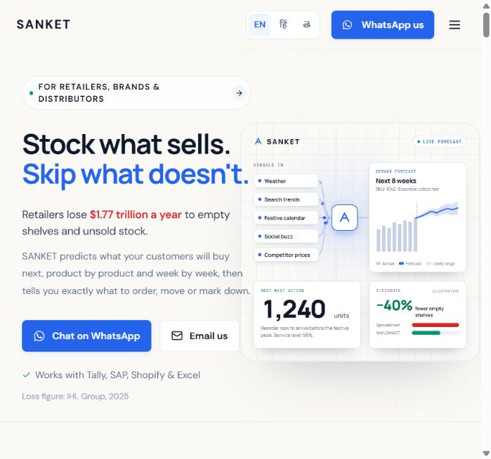
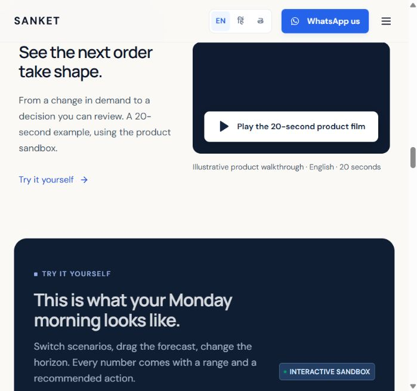
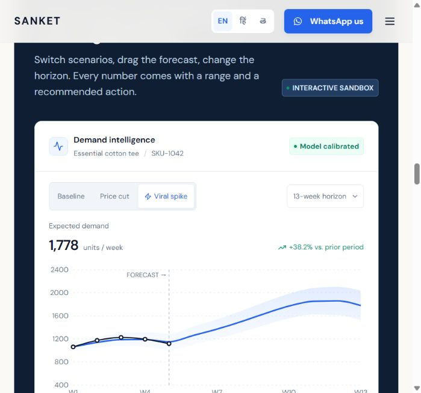
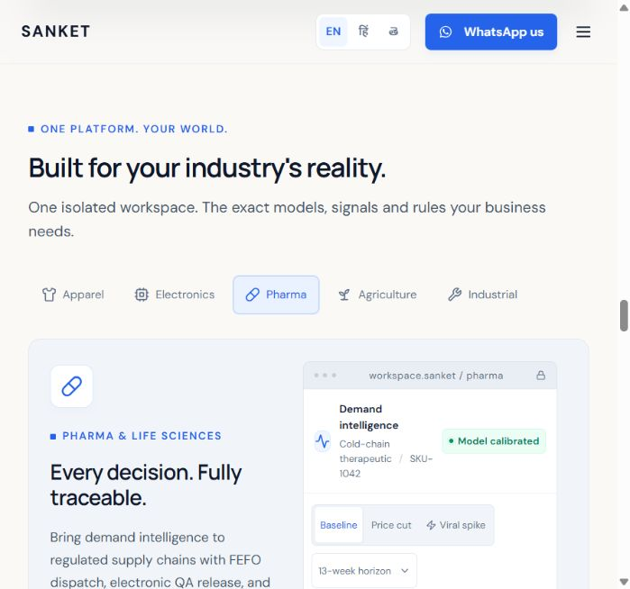
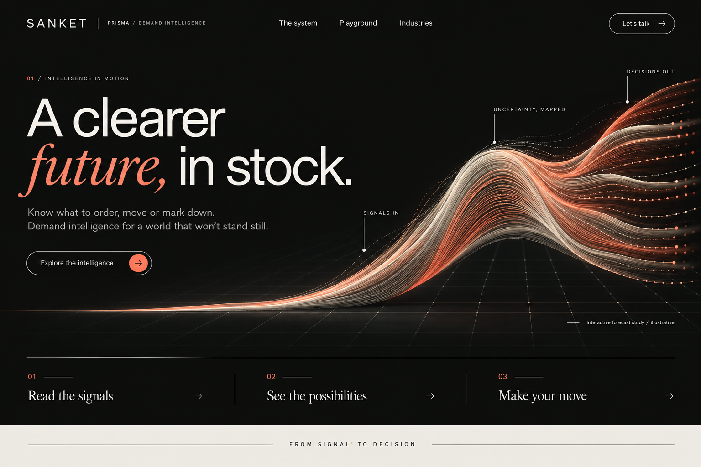

# SANKET — an intelligent world in motion

Design and implementation record · 19 October 2026

## 1. Grounding and live-site audit

Source: [existing SANKET site](https://sanket-swart.vercel.app/). The browser could access it; the web fetch tool could not. Findings below use the live browser, the source repository, and screenshots captured in this run. Earlier `qa/redesign/` captures were not used as current audit evidence.

SANKET / PRISMA presents demand forecasting and inventory decision support for retailers, brands, and distributors. Its practical promise is to help decide what to order, transfer, or mark down. The audience includes operational buyers using Indian ERP tools, global commerce platforms, POS systems, and spreadsheets. The conversion goal is a direct conversation with the builders through the existing WhatsApp number or email address. The product site is an interactive frontend; no forecasting backend, credentials, or live commerce connection is supplied in this repository.

### Live flow and evidence

| Step | Screen/action | Health | Finding and response |
| --- | --- | --- | --- |
| 1 | Home and navigation | Clear message; conventional presentation | The headline immediately explains the inventory problem. The white/blue split hero, rounded containers, and repeated card language provide little distinctive identity. Keep the product promise; replace the visual language with a forecast surface. At the captured narrow viewport, navigation is hidden behind a hamburger while contact is dominant. Add a clear product exploration path and a separate playground path. |
| 2 | Product-film introduction | Understandable; limited visual emphasis | The film has a clear duration, a real play action, and an illustrative label. Retain it, with stronger contrast and better connection to the sandbox. The captured screen shows the film and sandbox introduction, rather than the whole sandbox. |
| 3 | Sandbox, viral-spike state | Functional; dense | Scenario selection changes the forecast. The range and reorder recommendation make the product tangible. The narrow chart has small controls and technical detail competing with the story. Preserve all scenario/horizon controls, the demand slider, and the decision response; give the interface more space. |
| 4 | Pharma workspace | Functional; cramped at the captured width | Tabs update the industry and product. The two-column layout is squeezed at the source viewport, wrapping the product identifier across several lines. Stack the content and chart sooner on touch devices. Keep keyboard tab behavior and the illustrative workspace label. |

### Page and interaction inventory

The existing site has one page with anchor navigation; no sibling product routes were discovered in the application. It contains the home hero; six inventory-problem tabs; six public industry stories with All/India/Global filters, disclosures, and source links; a three-step explanation; a 20-second product film; an interactive forecast sandbox; five industry workspaces; four decision-engine examples; a searchable integration catalog; an INR/USD calculator; security descriptions; direct contact; and a footer.

Existing interactions include English/Hindi/Telugu switching with persistence, scenario changes, chart dragging and a keyboard-accessible demand slider, horizon selection, problem/industry keyboard navigation, optimization previews, connector details, adjustable calculator assumptions, email copying, native film playback, and stock-transfer replay. These remain available. The earlier 12-second hero video and illustrated-valley assets remain on disk, but are superseded in the visible hero.

The storytelling weakness is repetition: similar panels receive similar emphasis, so the visitor must decide what matters. The revision brings the product demonstration forward, puts historical industry stories after the practical business case, and gives each chapter a distinct composition. No testimonial, partnership, customer logo, capability count, or new outcome statistic was added. Existing numerical examples remain qualified as illustrative. “Your stack. Already connected.” was softened to “Fits the tools you already use.” because the catalog does not establish a live connection.

### Accessibility and technical constraints

Source screenshots alone cannot establish accessibility conformance. Visible risks include small chart labels, dense controls at narrow widths, and multiple competing reading paths. The source code already supplies semantic controls, a skip link, focus states, accessible tab behavior, and reduced-motion logic. Preserve and extend those foundations.

React 18, TypeScript, Vite, custom CSS/Tailwind, Recharts, Framer Motion, GSAP, and Lenis are already installed. Existing local edits refer to missing `WorldHero.tsx` and `world.css`; the initial production build fails on the missing module. The new experience replaces those broken imports. A snapshot of the starting source, README, HTML, and check script is retained in `archive/before-cinematic-20261019/`.

## 2. Three creative directions

### A — Cinematic Intelligence: probability made tangible

The idea is to make uncertainty visible as a woven surface: shared history enters from the left and several possible futures emerge on the right. One evolving object unites signals, forecasting, and a practical decision.

- Personality: atmospheric, precise, quietly ambitious.
- Palette: ink `#111311`, warm ivory `#eeece5`, signal coral `#ff8066`, and subdued botanical grays in working interfaces.
- Typography: oversized DM Sans, a Georgia italic for the human word “future,” and JetBrains Mono for annotations. Existing Devanagari and Telugu support is retained.
- Layout: left-aligned editorial headline, right-weighted sculpture, a three-part interactive rail, ivory explanation, dark product chapter, and a coral invitation.
- Signature element: a bespoke procedural probability surface in Three.js; original generated artwork is the static counterpart.
- Motion: calm continuous deformation, low-amplitude cursor response, explicit state morphs, and a restrained scroll-linked perspective shift. Major content reveals are short and directional.
- Interaction: choose signals/possibilities/decisions, pause the scene, manipulate the actual sandbox, and inspect industry-specific examples.
- Distinction: the visual metaphor is forecasting itself, rather than a generic representation of AI.

### B — Future Editorial: the inventory journal

The idea is a living editorial issue about the consequences of inventory decisions. Oversized typographic statements alternate with product evidence, like a journal moving from an observation to a working instrument.

- Personality: confident, human, candid, analytical.
- Palette: chalk `#f4f0e7`, carbon `#25251f`, vermilion `#d44e34`, and warm gray.
- Typography: very large condensed display type, a readable neutral sans, and restrained serif pull quotes drawn only from existing copy.
- Layout: twelve-column asymmetry, section numbers in a narrow left gutter, large typographic spreads, and edge-to-edge product interfaces. Historical examples become compact editorial case notes with source disclosures.
- Signature element: the phrase “Stock what sells” responds to the reader’s selected inventory problem; the underlying explanation changes with it.
- Motion: line masks, headline replacement, progress rules, and image crop reveals. No continuous 3D renderer.
- Interaction: problem-driven reading paths, explicit chapter index, inline calculator, and the existing sandbox.
- Distinction: combines the directness of operational software with the confidence of a cultural publication.

### C — Living Digital System: a supply chain that listens

The idea is a responsive diagram in which incoming demand signals travel through forecasting and resolve into order, transfer, or markdown paths. A node represents a product decision, rather than a decorative particle.

- Personality: systematic, exploratory, responsive, instrument-like.
- Palette: deep olive `#172018`, mineral white `#e7eadc`, chartreuse `#c3cf77`, and muted copper for exceptions.
- Typography: a neutral grotesk with a compact monospaced annotation layer; information appears close to the related node.
- Layout: a sticky visualization beside progressively revealed chapters; clear reading panels sit outside the network. On phones, three touch-selected stages replace the wide network.
- Signature element: one deliberate signal-to-decision network whose selected path corresponds to a scenario in the sandbox.
- Motion: sequential signal routing, path emphasis, camera reframing, and controlled state transitions.
- Interaction: select a signal, inspect its explanatory path, then change the corresponding sandbox scenario. Every essential node also has a text control.
- Distinction: a visually coherent explanation of SANKET’s product architecture; its main risk is diagram complexity and the temptation to imply live telemetry.

### Selection

| Criterion | A | B | C |
| --- | --- | --- | --- |
| Originality | Strong: probability as material | Strong typographic voice | Strong interaction, familiar network metaphor |
| Product relevance | Directly expresses forecasting uncertainty | Strong explanation, weaker central product metaphor | Directly expresses connectivity and decisions |
| Usability | Clear independent copy and controls | Strongest reading experience | Needs careful simplification |
| Feasibility | One bounded renderer plus a static fallback | Lowest rendering cost | More state coordination and explanatory overhead |
| Emotional impact | Highest depth and atmosphere | Confident and human | Engaging but more technical |

Choose A. Borrow B’s reading rhythm and disciplined editorial spacing. Avoid C’s persistent network complexity. The decision is based on product relevance and a distinctive still frame as much as on motion.

12ui was attempted as the design exploration tool. Its installer reported a Windows spawn error; the package runner worked but hosted drafting required a new account sign-in. No 12ui generation or conversion was completed. Built-in Image Gen produced the selected visual target and the fallback artwork; React/CSS/Three.js implement the working site. No automated 12ui fidelity score is claimed.

## 3. Experience architecture and wireframes

| Chapter | Desktop composition | Phone composition | Communication objective |
| --- | --- | --- | --- |
| Introduction | Large two-line headline; probability surface right; explicit exploration and demo links; three-part study rail | Two-line headline above the sculptural artwork; touch controls; lightweight bitmap | Identify the product and invite exploration within seconds |
| The world moves | Oversized statement left; explanation right; one connected rule | Statement, explanation, and compact signal sequence stacked | Explain why demand shifts matter |
| Inventory problems | Ranked text choices left; one selected explanation right | Choices then explanation in a single column | Connect the promise to the visitor’s current problem |
| How it works | Sticky heading beside three successive steps; benefits below | Natural vertical reading sequence | Explain connect → forecast → decide without requiring technical knowledge |
| Product chapter | Dark chapter title, film, then an ivory working interface and decision panel | Film, scenarios, chart, slider, then recommendation | Let visitors understand and manipulate the product example |
| Industries | Touch/keyboard tabs above a content-and-forecast workspace | Horizontally scrollable tabs and stacked content/chart | Show the realities of five existing industries |
| Decisions and integrations | Transfer example, four inspectable decisions, searchable catalog | Stacked decisions; compact catalog; expandable setup details | Connect insight with action and existing tools |
| Business case | Two-column editable profile and exact calculator result | Inputs followed by the result | Make the impact assumptions inspectable |
| Public examples and data care | Compact editorial case notes; quieter security band | Expandable notes and simple two-column security list | Provide context without implying customer endorsements |
| Invitation | Coral typographic close; existing WhatsApp and email links | Readable headline and stacked direct-contact rows | Make the next action unambiguous |

The fixed header exposes system/playground/industries on desktop. Touch navigation uses a native modal dialog with a complete index, browser focus containment, Escape dismissal, and focus return. Language remains immediately accessible. Every existing meaningful anchor is retained; `#journey` and `#intelligence` are added.

## 4. Visual and motion system

The probability surface has 100 line paths of 160 samples each. A shared history expands into a future fan. The signals state adds controlled variation, possibilities opens the fan, and decisions compresses it. Pointer movement changes perspective slightly; scrolling shifts its framing. This is an illustrative study, independent of the forecasting calculator.

Motion sequence:

1. First paint shows the headline and original optimized artwork. No artificial loader or blocked CTA.
2. Two headline lines reveal over roughly 0.9 seconds with a 0.12-second offset. Supporting copy follows within 0.3 seconds.
3. Capable desktop devices load the Three.js module separately. Its surface fades into place; the image remains as the fallback.
4. Explicit stage selection interpolates the geometry and updates an `aria-live` explanatory sentence.
5. The visitor can pause environmental deformation. The scene stops drawing when offscreen or the document is hidden; it renders at a capped pixel ratio and approximately 30 fps when active.
6. The next chapter draws a single connecting rule. On large screens, the explanation stays alongside successive how-it-works steps.
7. Section headings reveal once. Existing tab transitions, calculator contribution bars, and stock-transfer replay retain their clear functional roles.

Primary easing is a quick departure and gentle settle; typical content transitions are 0.25–0.9 seconds. Native touch scrolling remains available. Reduced-motion styling disables visual travel and smooth scroll. The hero skips WebGL when reduced motion, data saving, narrow screens, or a low reported memory budget calls for the static presentation. WebGL initialization/context loss also falls back to artwork.

Implementation: `src/CinematicExperience.tsx` owns the shell, hero, journey, and chapter titles. `src/ForecastSurface.tsx` owns the renderer and disposal. `src/cinematic.css` provides the new theme as the last shared stylesheet. Existing product behavior stays in `App.tsx`, `ROICalculator.tsx`, and `MotionExtras.tsx`. No additional animation framework was installed.

## 5. Validation and practical limits

Actual browser observations and assertions are in `qa/cinematic/verification.json`. Screenshots cover desktop, mobile, menu, languages, sandbox, industries, calculator, and breakpoint checks. The local UI was exercised through the in-app browser. `scripts/check-site.mjs` was updated as a repeatable regression check; its command-line browser runner was not used for this run.

Confirmed checks include stage selection, explanatory text, scene pause, forecast scenario/reorder linkage, forecast horizon/reset, pharma switching, connector filtering and setup details, exact USD calculator baselines, mobile dialog opening/Escape/focus return/navigation, language persistence, and layout bounds at 320/375/390/768/1024/1920px.

Production build and TypeScript checks pass. The production dependency audit reports no known vulnerabilities. The existing Vite development toolchain has audit findings; production frontend dependencies are separate from those development-only findings. Three.js is a separate lazy chunk; its raw size still triggers Vite’s advisory chunk-size warning.

No field Core Web Vitals, full WCAG 2.2 AA certification, low-power physical-device benchmark, or production backend validation is claimed. The reduced-motion branch was inspected in source; this browser session did not emulate the operating-system preference. Publishing was not requested, and the live Vercel site is unchanged.

The side-by-side target review is saved in `qa/cinematic/compare-target-production.png`. That review led to a wider future fan, softer plotting grid, a shorter desktop pause before the study controls, and a wider introductory text measure. The implemented header also includes the existing language controls and a direct sandbox link, both absent from the visual sketch.

The calculator and chart remain deterministic examples, integration selection displays setup information, and contact opens the visitor’s own communication app. No invented submission confirmation or fake server connection is used.

## 6. Follow-up review — 19 October 2026

The attached brief was reviewed against the existing implementation, rather than replacing the in-progress source. The live Vercel site was reopened and its full page inventory and original white/blue hero confirmed. The three-direction comparison and selected Cinematic Intelligence design above remain the implementation baseline.

The forecast renderer now cancels animation scheduling when offscreen or when the tab is hidden. A paused scene stops scheduling frames after stage and pointer interpolation settles; deliberate changes, scrolling, resize and visibility restore rendering. Conservative local geometry bounds replace repeated per-frame bounding-sphere scans. This reduces unnecessary CPU work without changing the visual direction. No device benchmark or Core Web Vitals score is inferred from this change.

The updated production build passes TypeScript and Vite compilation. Direct in-app browser checks confirmed pause/stage selection, viral-spike reorder response (2,170 units), Pharma content, the USD Enterprise calculator result ($1,120,000), mobile navigation, Escape dismissal and focus return. At 390px, the hero uses no canvas and has no horizontal page overflow. The inspected browser log contained no errors or warnings. Fresh review screenshots are `qa/cinematic/review-desktop.png` and `qa/cinematic/review-mobile.png`; earlier verification records remain separate.

12ui target alignment was retried against the existing selected image. It remains incomplete because account sign-in is required; no conversion, purchase, or automated fidelity score completed. The existing rendered implementation was visually reviewed directly. Publishing and backend integration remain outside this local delivery.
