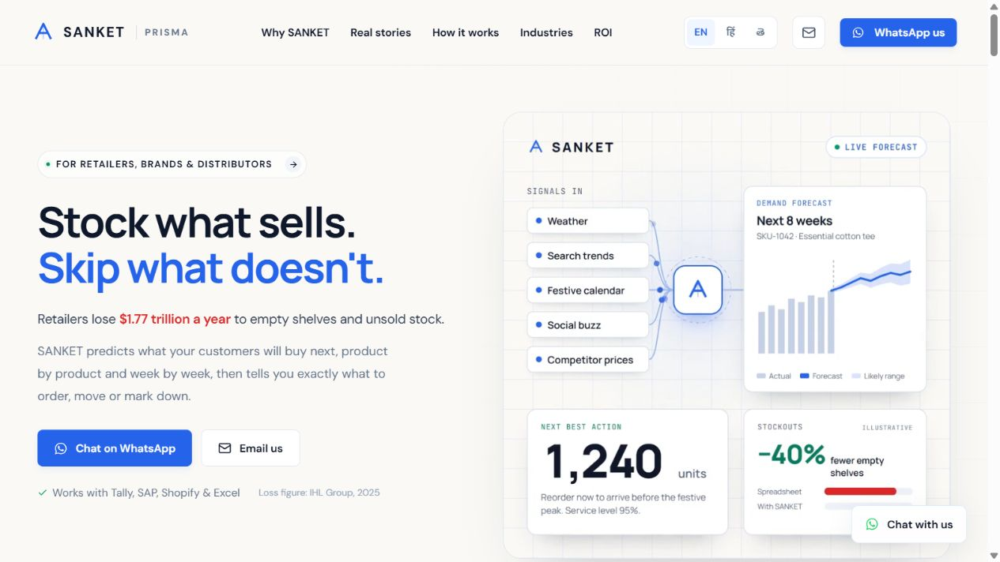
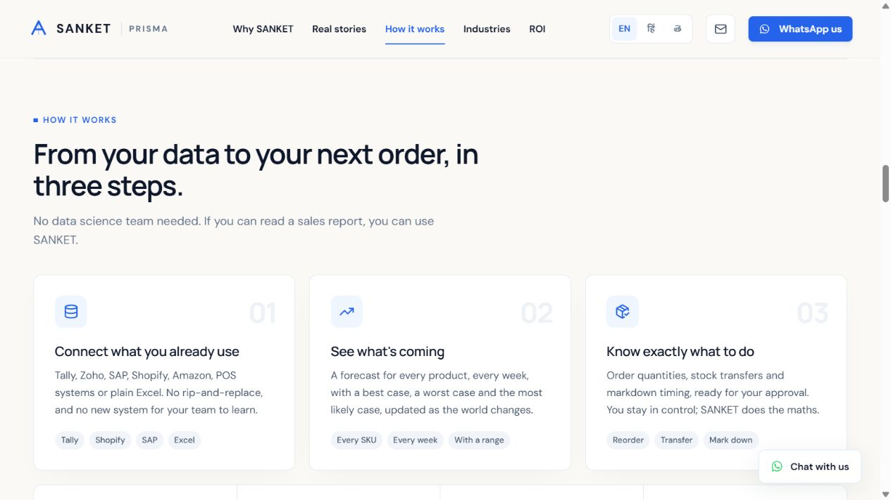
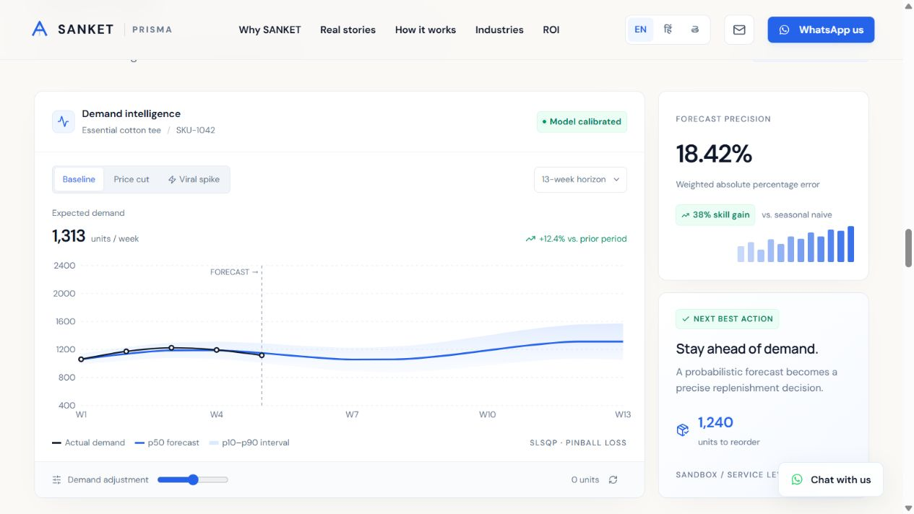
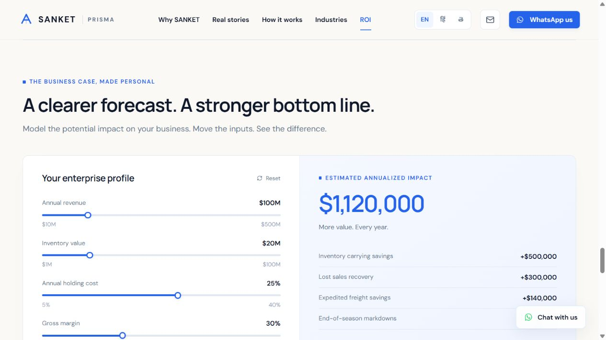

# SANKET content and design review

Reviewed the local site on 14 October 2026. Scope: desktop first impression, explanation, sandbox presentation and ROI entry. No website code changed.

## 1. First impression — strong foundation; clearer next action needed

Keep “Stock what sells. Skip what doesn't.”, the restrained blue and ivory palette and the signal-to-decision visual. Give visitors an immediate “Try the demo” link beside “Chat on WhatsApp”; keep email as a quieter contact option. Replace the global-loss-led supporting copy with a direct description of the buyer's task. Suggested copy: “Know what to reorder, where to move stock, and when to mark it down. SANKET turns sales and inventory data into weekly demand forecasts and recommendations for your team to review.” Move the sourced global statistic into supporting context.

Clarify capability status. The project README describes the site as a simulated frontend; the hero says “Works with Tally, SAP, Shopify & Excel” and the animation says “Live forecast.” Label illustrative examples clearly, and distinguish available integrations from planned or custom connections. Show verified customer evidence only when available.

## 2. Product explanation — clear; appears too late in the page

The three-step explanation is readable and the approval wording gives buyers useful reassurance. Move it ahead of the six public inventory-failure stories, and place the sandbox directly after it. Retain one or two stories with an expandable collection. Those stories explain the problem but do not establish SANKET customer outcomes.

Suggested page order: hero, short problem summary, how it works, demo, industries, supported integrations, evidence, ROI, FAQ/security, contact. Add practical FAQ answers on required data, setup, approval, ownership and support; publish only confirmed details.

## 3. Forecast sandbox — useful demonstration; technical hierarchy needs revision

Make the reorder recommendation the visual anchor: quantity, timing, reason and user approval. The chart should explain that recommendation. Rename “Forecast precision 18.42%” to “Forecast error (WAPE) 18.42%” and explain that lower is better. “Precision” paired with an error percentage is misleading. Use “Expected demand” and “Likely range” in the chart; put quantile labels, SLSQP and pinball loss behind a technical-details disclosure. Add a short prompt such as “Choose Viral spike to see how the order changes.” Label the data as simulated beside the metrics, including the model-calibrated badge.

The floating chat overlaps the lower action-card area in this capture; reserve space or collapse it while interactive panels are in use. Small gray labels and pale chart elements warrant contrast measurement and larger text. WCAG AA requires 4.5:1 for ordinary text and 3:1 for large text: https://www.w3.org/WAI/WCAG22/Understanding/contrast-minimum.html . This review identifies visual risks, not measured failures.

## 4. ROI entry — clear result; audience and assumptions need alignment

The savings breakdown is useful. Add INR/USD selection and relevant business-size presets; the current $100M default and $10M minimum may exclude smaller buyers implied by the broader retailer positioning. Add exact number entry alongside sliders. Offer conservative, expected and optimistic assumptions, with the assumption details adjacent to the estimate. Freight and markdown savings currently use fixed baselines documented in the site; expose these inputs so the business case reflects the visitor's business. Describe the result as estimated annual benefit; true ROI additionally needs implementation and service costs.

## Priority

1. Clarify simulated data and available capability claims.
2. Move how-it-works and the demo earlier; add a hero demo link.
3. Correct forecast-error labeling and emphasize the decision.
4. Localize and broaden the calculator.
5. Improve contrast, small labels and floating-chat placement.
6. Complete Hindi/Telugu coverage in demo and calculator; the README currently documents partial translation.
7. Add factual onboarding FAQ, founder/company identity and a business-domain email when available.

## Limits

Screenshots and page structure support this review. Mobile layout, keyboard-only completion, screen-reader behavior, precise contrast ratios, performance and conversion outcomes were not tested. No customer results, external historical statistics, integrations or security capabilities were independently validated. Recommendations are design judgments to validate with representative buyers.
